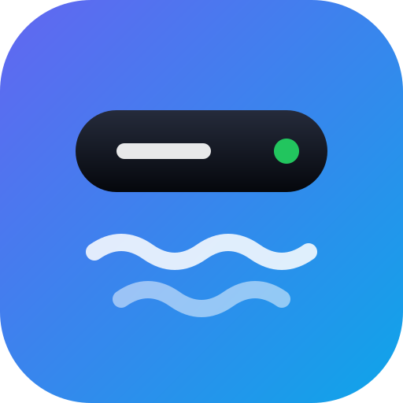
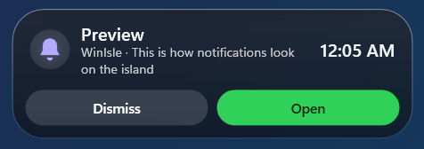
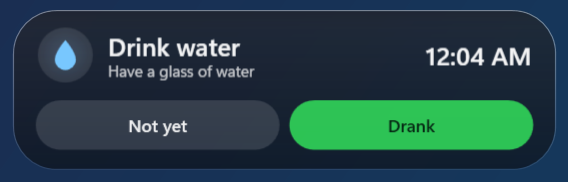
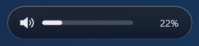
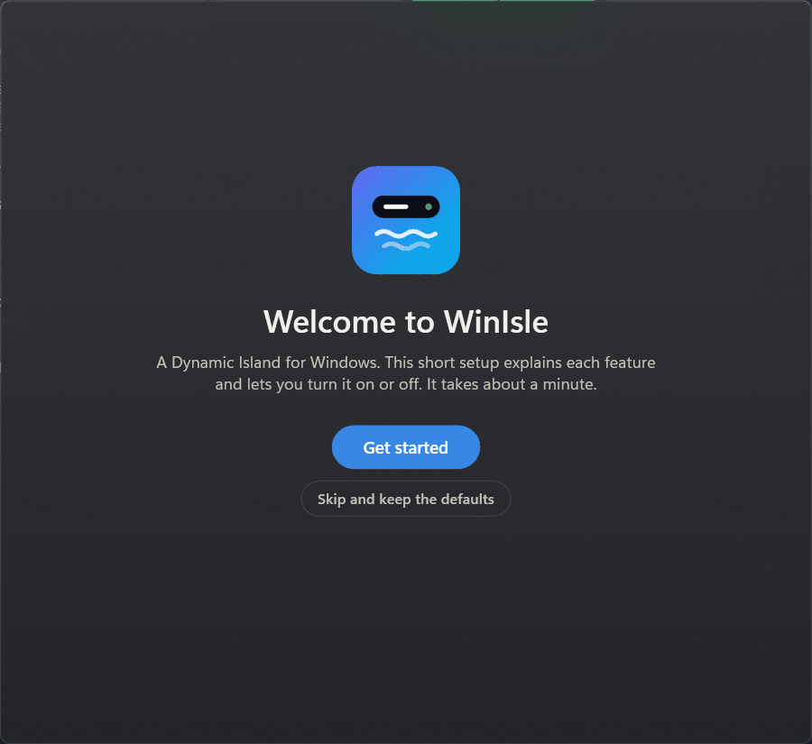
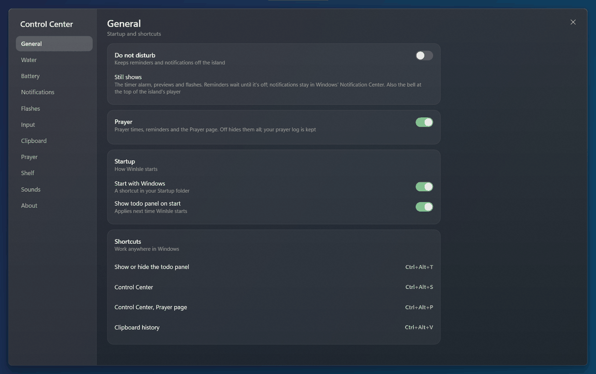

<p align="center">
  
</p>

<h1 align="center">WinIsle</h1>

<p align="center">
  A Dynamic Island for Windows: reminders, notifications, media controls, a timer, clipboard history and a file shelf, in one glass pill at the top of your screen.
</p>

<p align="center">
  <a href="https://github.com/NihapMrm/WinIsle/releases/latest"></a>
  <a href="https://github.com/NihapMrm/WinIsle/releases"></a>
  
  <a href="LICENSE"></a>
  <a href="CONTRIBUTING.md"></a>
</p>

<p align="center">
  <a href="https://github.com/NihapMrm/WinIsle/releases/latest/download/WinIsle-Setup.exe"><b>Download WinIsle-Setup.exe</b></a>
  ·
  <a href="https://nihapmrm.github.io/WinIsle/">Install guide</a>
  ·
  <a href="docs/guide.md">User guide</a>
  ·
  <a href="CHANGELOG.md">Changelog</a>
</p>

<p align="center">
  
</p>

---

## Contents

- [Why WinIsle](#why-winisle)
- [What it does](#what-it-does)
- [All features](#all-features)
- [Make it yours](#make-it-yours)
- [Install](#install)
- [Keyboard shortcuts](#keyboard-shortcuts)
- [Privacy](#privacy)
- [FAQ](#faq)
- [Build from source](#build-from-source)
- [Roadmap](#roadmap)
- [Contributing](#contributing)
- [Support](#support)
- [License](#license)

## Why WinIsle

Windows spreads small things across the screen: notification banners in one corner, the volume pop-up in another, reminders in separate apps, and no clipboard history worth using. WinIsle gathers them into one place at the top centre of the screen, where your eyes already go, and stays out of the way the rest of the time.

- **One place to look.** Reminders, notifications and status changes all appear on the island.
- **Asks, then gets out of the way.** Cards stay until you answer, then the island tucks back into a thin line.
- **Light and private.** One small exe, no account, no internet connection, nothing to install besides itself.
- **Yours to shape.** Every feature can be turned off, and every interval and threshold can be changed.

## What it does

The island sits at the top centre of your screen as a thin glass line. When something needs you, it grows into a card with buttons, then tucks back up.

<table>
  <tr>
    <td width="50%" valign="top">
      <b>Reminders that wait for an answer</b><br>
      Water every 90 minutes, battery alarms at 15% and 95%, and prayer times worked out offline. Each one stays until you answer it.
      <br><br>
    </td>
    <td width="50%" valign="top">
      <b>A charging animation</b><br>
      Plug in and a battery fills on the island, counting up at the real charge rate with the charging power in watts. Unplug and it drains away.
      <br><br>
    </td>
  </tr>
  <tr>
    <td width="50%" valign="top">
      <b>Notifications from every app</b><br>
      Messages land on the island with Open and Dismiss, as in the picture at the top. Calls stay until you answer. Windows' own banners are turned off, so you never see one twice.
    </td>
    <td width="50%" valign="top">
      <b>Volume and brightness</b><br>
      A slim bar replaces Windows' pop-up. Scroll on it to adjust, or hold the mouse wheel down and scroll anywhere.
      <br><br>
    </td>
  </tr>
  <tr>
    <td width="50%" valign="top">
      <b>Clipboard history</b><br>
      <code>Ctrl+Alt+V</code> opens everything you've copied: text, links, images and files. Type to search, press Enter to paste, pin what you reuse.
      <br><br>
    </td>
    <td width="50%" valign="top">
      <b>A todo panel</b><br>
      A small always-on-top task list. Click a task to move it from to do, to ongoing, to done. <code>Ctrl+Alt+T</code> shows or hides it.
      <br><br>
    </td>
  </tr>
</table>

## All features

**On the island**
- **Media player:** hover the island to control whatever Windows is playing, from Spotify, a browser or any media app, with cover art, a seek bar and volume.
- **Windows notifications** from every app, with the app's icon, up to three lines of text, and Open and Dismiss. Several from one app merge into one. Calls stay until answered.
- **Flashes:** charging and unplugging, volume, brightness, Bluetooth devices connecting (with their battery level) and new screenshots.
- **Camera and microphone dots** while an app is using them; hover to see which app.
- **Do not disturb** keeps reminders and notifications off the island until you turn it off.

**Reminders**
- **Water** every 90 minutes, with "Not yet" to ask again in 10 minutes.
- **Battery alarm** at 15% to plug in and 95% to unplug.
- **Prayer times** calculated offline for your location, with Not yet, Later and Prayed, and a dashboard with history, streaks and charts. Can be switched off completely.

**Tools**
- **Clipboard history** with search, pins, paste with Enter or `Ctrl+1`…`Ctrl+9`, and images and files as thumbnails.
- **File shelf:** drag files to the top of the screen to hold them, then drag them out to any app. New screenshots can go there automatically.
- **Timer** with rolling hour, minute and second wheels and an alarm.
- **Mirror:** a live view from your camera, right on the island.
- **Todo panel** that stays on top.

**Control**
- **First-run setup** that explains each feature with its switch.
- **Control Center** for every setting, with live previews. Changes apply at once.
- **Volume keys and mouse wheel volume**, handled by the island.
- **Start with Windows**, and one copy at a time: starting it again shows the running copy.

Every feature is described in the [user guide](docs/guide.md).

## Make it yours

On first start, a short setup explains each feature and lets you turn it on or off, with **Try it** buttons that show a sample on the island.

<p align="center">
  
  
  
</p>

Everything else is in the **Control Center** (`Ctrl+Alt+S`): every switch, interval, threshold and sound, applied the moment you change it.

<p align="center">
  
</p>

## Install

1. Download **[WinIsle-Setup.exe](https://github.com/NihapMrm/WinIsle/releases/latest/download/WinIsle-Setup.exe)** and run it. It installs for your account only, so it doesn't need administrator rights.
2. If Windows shows **"Windows protected your PC"**, click **More info**, then **Run anyway**. The installer isn't code-signed yet.
3. Follow the short setup. The island appears at the top centre of your screen.

| | |
|---|---|
| **Portable** | Download `WinIsle.exe` from [Releases](https://github.com/NihapMrm/WinIsle/releases) and run it from any folder. |
| **Update** | Run the newest `WinIsle-Setup.exe`. Your tasks and settings are kept. |
| **Uninstall** | **Settings › Apps › Installed apps › WinIsle › Uninstall.** Windows notification banners come back on. Your data stays in `%LOCALAPPDATA%\WinIsle` until you delete it. |
| **Requirements** | Windows 10 or 11. Nothing else; WinIsle uses the .NET Framework built into Windows. |

## Keyboard shortcuts

| Shortcut | What it does |
|---|---|
| `Ctrl+Alt+S` | Control Center |
| `Ctrl+Alt+T` | Show or hide the todo panel |
| `Ctrl+Alt+V` | Clipboard history |
| `Ctrl+Alt+P` | Prayer page (while prayer is on) |
| `Ctrl+Shift+Q` in the todo panel | Quit WinIsle |

## Privacy

WinIsle makes no internet connections. Notification text, clipboard history and camera frames stay on your PC. Your data lives in `%LOCALAPPDATA%\WinIsle`.

Clipboard history does record passwords you copy. Turn it off in the setup or the Control Center if you'd rather it didn't. See [Privacy and permissions](docs/guide.md#privacy-and-permissions) and the [security policy](SECURITY.md).

## FAQ

**Is it safe? Windows warned me about the installer.**
The installer isn't code-signed yet, which costs money, so SmartScreen doesn't recognise it. The full source is here, and you can [build it yourself](#build-from-source) with tools already on your PC.

**Does it slow down my PC?**
It's one small process. It checks notifications and media once a second, which uses a little CPU continuously; the other features wait for Windows to report a change.

**Will I miss notifications?**
No. Notifications still go to the Windows Notification Center. WinIsle only turns off the pop-up banners, so you don't see each one twice. Uninstalling turns them back on.

**Does it work on several monitors?**
The island shows on your main display.

**Does it work with my music app?**
Anything that shows in Windows' own media controls works, including Spotify, browsers and most media players.

**Can I turn off the prayer features?**
Yes. Switch off **Prayer** in the setup or on the Control Center's General page. That hides the page, the button and the reminders.

**Where are my settings? How do I back them up?**
In `%LOCALAPPDATA%\WinIsle`. Copy that folder to back them up or move them to another PC.

More answers are in [Troubleshooting](docs/guide.md#troubleshooting) and [Known limitations](docs/guide.md#known-limitations).

## Build from source

No SDK or NuGet packages: `build.cmd` uses the C# compiler that ships with Windows.

```cmd
git clone https://github.com/NihapMrm/WinIsle.git
cd WinIsle
build.cmd
WinIsle.exe --check
```

`--check` runs the built-in self-tests; exit code `0` means all passed. The code is C# 5 with WPF, so newer syntax such as `?.` and `$"..."` doesn't compile. To build the installer, install [Inno Setup 6](https://jrsoftware.org/isinfo.php) and run `iscc /DAppVersion=1.2.0 installer.iss`.

```
src/
  Program.cs          Entry point and command-line options
  Island/             The island: shapes, reminders, player, flashes, sounds
  ControlCenter/      The settings window
  Setup/              First-run setup
  Shared/             Settings, data folder, glass windows
  Clipboard/  Shelf/  Timer/  Mirror/  Media/  Notifications/  ...   One folder per feature
```

The [user guide](docs/guide.md#project-layout) maps every file.

## Roadmap

Ideas being considered, not promises. Comment on an issue or open one if you'd like something here.

- Code-signed installer, so SmartScreen stops warning
- Automatic update check
- A winget package
- The island on every monitor
- Call detection in languages other than English
- Glass that updates live as windows move behind it

## Contributing

Bug reports, ideas, documentation and code are all welcome.

- Read the **[contributing guide](CONTRIBUTING.md)** for setup, code rules and how to add a setting, reminder or page.
- Look for issues labelled [good first issue](https://github.com/NihapMrm/WinIsle/labels/good%20first%20issue) to get started.
- Follow the **[code of conduct](CODE_OF_CONDUCT.md)**.
- Report security problems privately, as described in the **[security policy](SECURITY.md)**.

## Support

- **Questions and ideas:** [Discussions](https://github.com/NihapMrm/WinIsle/discussions)
- **Bugs:** [open a bug report](https://github.com/NihapMrm/WinIsle/issues/new?template=bug_report.yml)
- **Like it?** Star the repository so others can find it.

## License

WinIsle is free and open source under the [MIT License](LICENSE).
