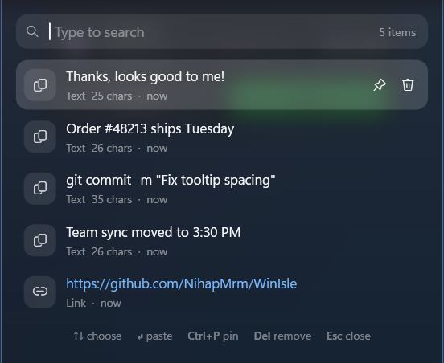
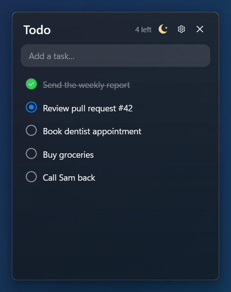
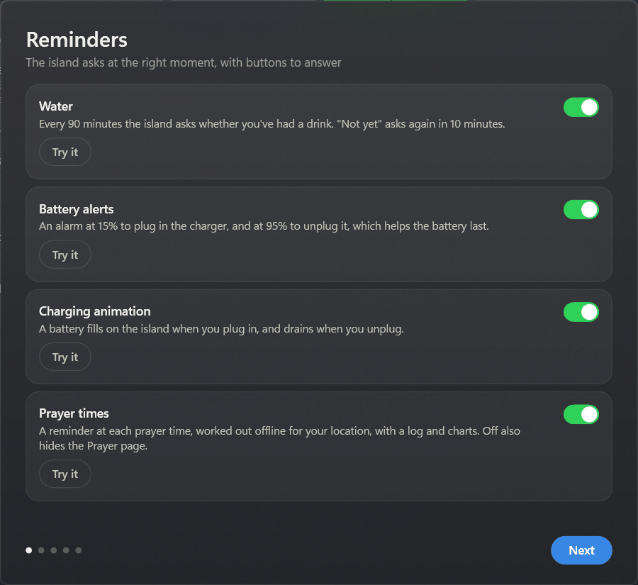
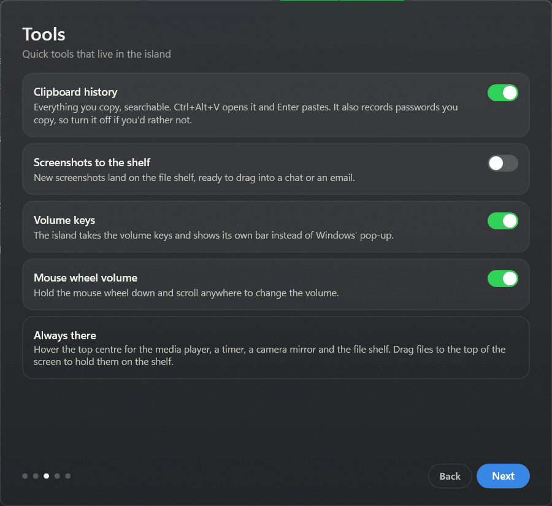

<p align="center">
  
</p>

<h1 align="center">WinIsle</h1>

<p align="center">
  A Dynamic Island for Windows: reminders, notifications, media controls, a timer, clipboard history and a file shelf, in one glass pill at the top of your screen.
</p>

<p align="center">
  <a href="https://github.com/NihapMrm/WinIsle/releases/latest"></a>
  
  <a href="LICENSE"></a>
</p>

<p align="center">
  <a href="https://github.com/NihapMrm/WinIsle/releases/latest/download/WinIsle-Setup.exe"><b>Download WinIsle-Setup.exe</b></a>
  ·
  <a href="https://nihapmrm.github.io/WinIsle/">Install guide</a>
  ·
  <a href="docs/guide.md">User guide</a>
</p>

<p align="center">
  
</p>

---

## What it does

The island sits at the top centre of your screen as a thin glass line. When something needs you, it grows into a card with buttons, then tucks back up.

<table>
  <tr>
    <td width="50%" valign="top">
      <b>Reminders that wait for an answer</b><br>
      Water every 90 minutes, battery alarms at 15% and 95%, and prayer times worked out offline. Each one stays until you answer it.
      <br><br>
    </td>
    <td width="50%" valign="top">
      <b>A charging animation</b><br>
      Plug in and a battery fills on the island, counting up at the real charge rate with the charging power in watts. Unplug and it drains away.
      <br><br>
    </td>
  </tr>
  <tr>
    <td width="50%" valign="top">
      <b>Notifications from every app</b><br>
      Messages land on the island with Open and Dismiss. Calls stay until you answer. Windows' own banners are turned off, so you never see one twice.
    </td>
    <td width="50%" valign="top">
      <b>Volume and brightness</b><br>
      A slim bar replaces Windows' pop-up. Scroll on it to adjust, or hold the mouse wheel down and scroll anywhere. Bluetooth devices and the camera and microphone get flashes too.
      <br><br>
    </td>
  </tr>
  <tr>
    <td width="50%" valign="top">
      <b>Clipboard history</b><br>
      <code>Ctrl+Alt+V</code> opens everything you've copied: text, links, images and files. Type to search, press Enter to paste, pin what you reuse.
      <br><br>
    </td>
    <td width="50%" valign="top">
      <b>A todo panel</b><br>
      A small always-on-top task list. Click a task to move it from to do, to ongoing, to done. <code>Ctrl+Alt+T</code> shows or hides it.
      <br><br>
    </td>
  </tr>
</table>

Hover the island for a **media player** that works with Spotify, browsers and any app Windows knows is playing, plus a **timer**, a **camera mirror** and a **file shelf** you can drag files onto.

## Make it yours

On first start, a short setup explains each feature and lets you turn it on or off, with **Try it** buttons that show a sample on the island.

<p align="center">
  
  
  
</p>

Everything else is in the **Control Center** (`Ctrl+Alt+S`): every switch, interval, threshold and sound, applied the moment you change it.

<p align="center">
  
</p>

## Install

1. Download **[WinIsle-Setup.exe](https://github.com/NihapMrm/WinIsle/releases/latest/download/WinIsle-Setup.exe)** and run it. It installs for your account only, so it doesn't need administrator rights.
2. If Windows shows **"Windows protected your PC"**, click **More info**, then **Run anyway**. The installer isn't code-signed yet.
3. Follow the short setup. The island appears at the top centre of your screen.

Prefer no installer? Download the portable `WinIsle.exe` from [Releases](https://github.com/NihapMrm/WinIsle/releases) and run it from any folder. To uninstall, use **Settings › Apps › Installed apps**.

**Requirements:** Windows 10 or 11. Nothing else; it uses the .NET Framework built into Windows.

## Keyboard shortcuts

| Shortcut | What it does |
|---|---|
| `Ctrl+Alt+S` | Control Center |
| `Ctrl+Alt+T` | Show or hide the todo panel |
| `Ctrl+Alt+V` | Clipboard history |
| `Ctrl+Alt+P` | Prayer page (while prayer is on) |

## Privacy

WinIsle makes no internet connections. Notification text, clipboard history and camera frames stay on your PC. Clipboard history does record passwords you copy; turn it off in the setup or the Control Center if you'd rather it didn't. Your data lives in `%LOCALAPPDATA%\WinIsle`. The [user guide](docs/guide.md#privacy-and-permissions) has the details.

## Build from source

No SDK or NuGet packages: `build.cmd` uses the C# compiler that ships with Windows.

```cmd
git clone https://github.com/NihapMrm/WinIsle.git
cd WinIsle
build.cmd
WinIsle.exe --check
```

`--check` runs the built-in self-tests; exit code `0` means all passed. The code is C# 5 with WPF, so newer syntax such as `?.` and `$"..."` doesn't compile. To build the installer, install [Inno Setup 6](https://jrsoftware.org/isinfo.php) and run `iscc /DAppVersion=1.2.0 installer.iss`.

The [user guide](docs/guide.md) covers every feature, the command-line options, the project layout, troubleshooting and known limitations.

## Contributing

Issues and pull requests are welcome. Keep to C# 5, and run `WinIsle.exe --check` before sending a change.

## License

[MIT](LICENSE)
